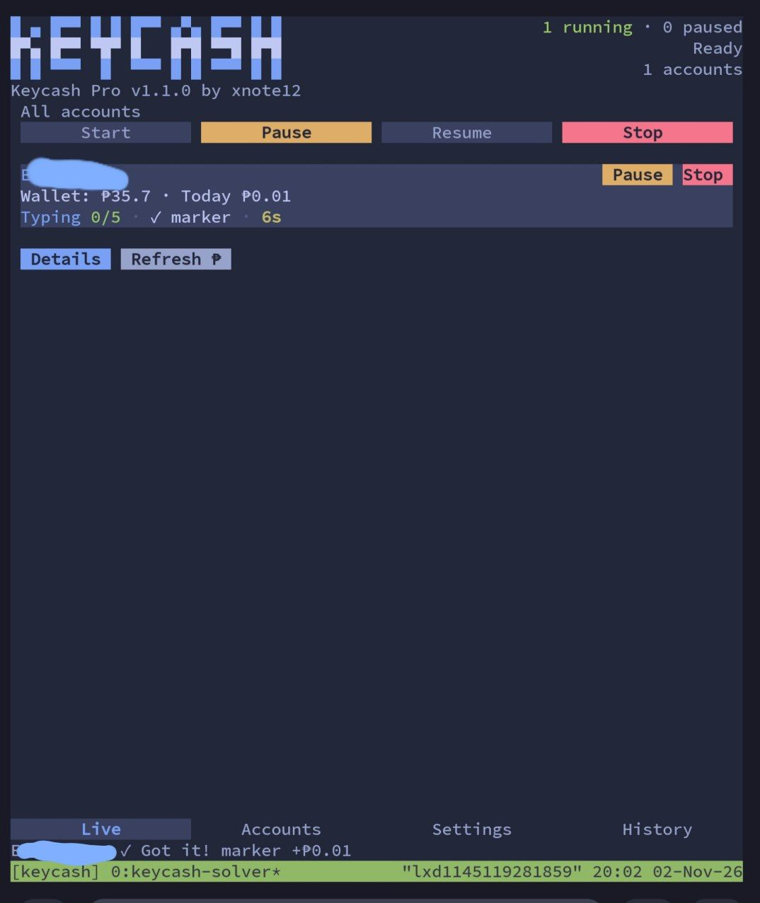

# Keycash Pro

**Keycash Pro v1.1.1 by xnote12**

Terminal-based multi-account Keycash task solver for:

- Typing tasks
- Math tasks
- Emoji tasks
- Multiple accounts with separate proxy assignments

## Sneak peek



## Multi-account proxy support

Open **Settings → Proxies** or press `p` on the Settings tab. Add one HTTP proxy per line:

```text
host:port:username:password
```

Each enabled account receives its own persistent proxy. Use at least as many proxies as simultaneously active accounts. A failing proxy is replaced after three connection failures, while a Cloudflare-blocked proxy is replaced immediately. Use **Check** to test the saved proxy list against the Keycash login page.

Proxy credentials are stored in the private application data directory and are excluded from interface snapshots and logs.

## Termux installation

Supported platform: ARM64 Android using Termux.

```sh
pkg install -y curl
curl -fsSL https://github.com/samperez10/keycashpro-v2/releases/latest/download/install.sh -o install-keycash.sh
bash install-keycash.sh
keycash
```

## Alpine Linux installation

Supported platform: Alpine Linux x86_64.

```sh
curl -fsSL https://github.com/samperez10/keycashpro-v2/releases/latest/download/install.sh -o install-keycash.sh
bash install-keycash.sh
keycash
```

If `keycash` is not immediately found after a non-root installation:

```sh
export PATH="$HOME/.local/bin:$PATH"
keycash
```

## Windows portable executable

[Download KeycashSolver-Portable-x86_64.exe](https://github.com/samperez10/keycashpro-v2/releases/latest/download/KeycashSolver-Portable-x86_64.exe)

No installer, ZIP extraction, Python installation, or adjacent dependency folder is required. The window uses a fixed, non-resizable 72 × 36 compact layout.
