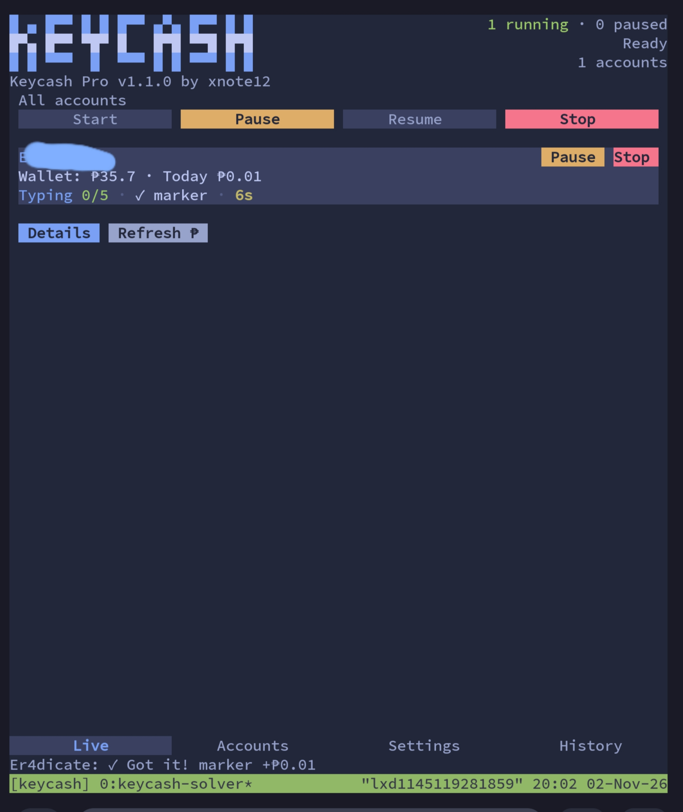

# Keycash Pro

**Keycash Pro v1.2.1 by xnote12**

Terminal-based multi-account Keycash task solver for:

- Typing tasks
- Math tasks
- Emoji tasks
- Multiple accounts with separate proxy assignments

## Sneak peek



## Multi-account proxy support

Open **Settings → Proxies** or press `p` on the Settings tab. Add one HTTP proxy per line:

```text
host:port:username:password
```

Each enabled account receives its own persistent proxy. Use at least as many proxies as simultaneously active accounts. A failing proxy is replaced after three connection failures, while a Cloudflare-blocked proxy is replaced immediately. Use **Check** to test the saved proxy list against the Keycash login page.

Proxy credentials are stored in the private application data directory and are excluded from interface snapshots and logs.

## Connection recovery

Network failures are retried with bounded exponential backoff and jitter. HTTP 429 rate limits use a separate cooldown and respect `Retry-After`. Session expiry refreshes login once, proxy failures rotate the proxy, and a submission whose response is lost is never replayed. Settings exposes retry count, initial and maximum retry delay, rate-limit cooldown, max consecutive errors, and unknown-response handling.

## Supported release platforms

| Platform | Architecture |
| --- | --- |
| Termux | aarch64 |
| Alpine 3.23 | x86_64, aarch64 |
| Debian 13 | x86_64 |
| Ubuntu 22.04 LTS | x86_64, aarch64, armhf |
| Ubuntu 24.04 LTS | x86_64 |
| Ubuntu 26.04 LTS | x86_64 |
| Windows | x86_64 portable |

The Linux/Termux installers create the `keycash` command and the `keycash-solver` alias, add the install directory to the shell profile when needed, verify the package, and preserve private account data.

## Installation

One source-free installer handles Termux, Alpine, Debian and Ubuntu. It detects the OS, CPU and Python ABI, downloads the matching package, verifies its hashes, runs the offline self-test, installs the `keycash` command and the `keycash-solver` alias, adds the install directory to the shell profile when needed, and preserves private account data.

```sh
curl -fsSL https://github.com/samperez10/keycashpro-v2/releases/latest/download/install.sh -o install-keycash.sh
bash install-keycash.sh
keycash
```

The same archive-local `install.sh` is used on every Unix platform. It supports:

- Termux aarch64
- Alpine 3.23 x86_64 / aarch64
- Debian 13 x86_64
- Ubuntu 22.04 x86_64 / aarch64 / armhf
- Ubuntu 24.04 / 26.04 x86_64

## Windows portable executable

[Download KeycashSolver-Portable-x86_64.exe](https://github.com/samperez10/keycashpro-v2/releases/latest/download/KeycashSolver-Portable-x86_64.exe)

Windows remains the existing portable single-file executable. No installer, ZIP extraction, Python installation or adjacent dependency folder is required. The launcher keeps the outer Windows Terminal window in a fixed compact portrait layout while allowing the terminal to report its real visible rows.
